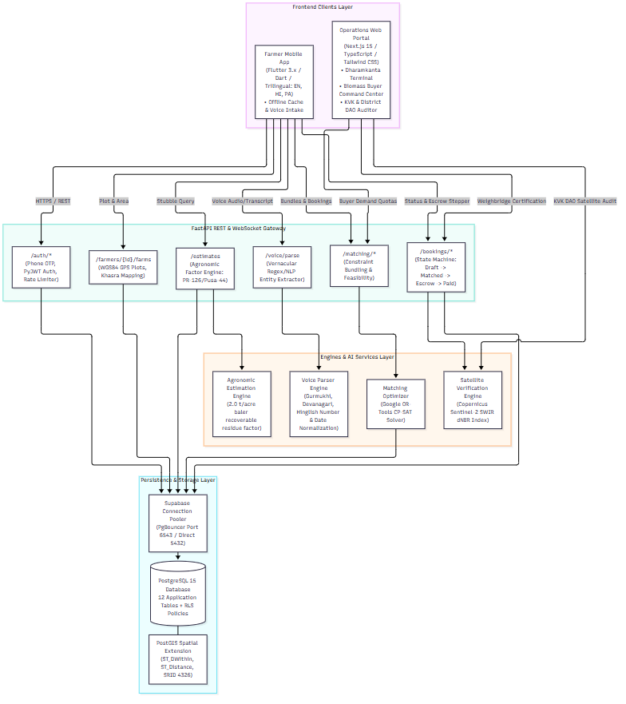

<p align="center">
  
  
  
  
</p>

<h1 align="center">🌾 ParaliSetu — ਪਰਾਲੀ ਸੇਤੁ</h1>

<p align="center">
  <strong>Voice-First Stubble Management & Agronomic Marketplace Platform</strong><br/>
  <em>Eliminating parali burning across Northwest India by connecting farmers, balers, logistics, and biomass buyers through automated escrow and satellite verification.</em>
</p>

<p align="center">
  <a href="#-about-the-project">About</a> •
  <a href="#-who-it-helps">Who It Helps</a> •
  <a href="#-feature-implementation-status-deck-facts">Feature Status</a> •
  <a href="#-system-architecture">Architecture</a> •
  <a href="#-quick-start--setup-windows">Setup Guide</a> •
  <a href="#-environment-variable-names">Environment Variables</a> •
  <a href="#-how-to-run-tests">Running Tests</a> •
  <a href="#-demo-login-credentials">Demo Login</a> •
  <a href="#-simulated-data--agronomic-assumptions">Assumptions & Simulated Data</a> •
  <a href="#-ai-tools--models-used">AI Tools Used</a> •
  <a href="#-credits--acknowledgments">Credits</a> •
  <a href="#-license">License</a>
</p>

---

## 📖 About the Project

**ParaliSetu** (*"Bridge for Paddy Straw"*) is a voice-first, multi-stakeholder agricultural logistics and marketplace platform built to solve the annual stubble burning crisis in Punjab, Haryana, and western Uttar Pradesh.

Every October and November, farmers face an acute **10–15 day window** between the paddy harvest and wheat sowing. Due to prohibitive machinery costs and labor shortages, over **20 million tonnes** of crop residue (*parali*) are burned in open fields, blanketing the Indo-Gangetic Plain and Delhi-NCR in severe toxic smog (PM₂.₅ and PM₁₀ spikes exceeding 500+ AQI).

Government fines (₹2,500–₹15,000 per incident under CAQM directives) punish farmers without providing a viable economic exit. **ParaliSetu transforms crop waste into guaranteed farmer income:**

```
Farmer speaks in Punjabi/Hindi/English
         ↓
Agronomic engine calculates recoverable baled stubble (PAU ground-truth math)
         ↓
Google OR-Tools CP-SAT engine solves multi-sided matching (Farmer ↔ Baler ↔ Truck ↔ Bio-CNG Buyer)
         ↓
Buyer escrow allocates funds automatically on booking confirmation
         ↓
Dharamkanta weighbridge digitally certifies certified net scale weight
         ↓
Instant escrow payout released to farmer + Copernicus Sentinel-2 satellite confirms zero burn
         ↓
Official KVK No-Burn Certificate issued & state subsidy eligibility unlocked
```

---

## 🎯 Who It Helps

ParaliSetu provides purpose-built interfaces tailored to 6 distinct agricultural and industrial stakeholders:

| Stakeholder | Interface | Value Delivered |
| :--- | :--- | :--- |
| 🌾 **Marginal & Smallholder Farmers** | Flutter Android App (Voice-first, Trilingual) | Monetize crop residue (earn **₹1,800–₹3,200/acre**) with zero typing. Avoid harsh CAQM penalties and soil nutrient depletion. |
| 👥 **Kisan Mitras & Village Youth** | Android App (Agent Mode) | Assist elderly or non-smartphone-owning farmers in booking baling runs. |
| 🏭 **Biomass Buyers** (Bio-CNG, Pellet, & Paper Plants) | Next.js Operations Web Portal | Secure reliable daily industrial feedstock (100–300+ tonnes/day) with locked procurement prices and automated escrow vaulting. |
| 🚜 **Baler Contractors & CHCs** | Web Portal & SMS Dispatch | Get contiguous, clustered 25–40 acre harvest routes, eliminating deadhead travel and maximizing equipment ROI. |
| ⚖️ **Dharamkanta (Weighbridge) Operators** | Lightweight Web Scale Terminal | One-click certified gross and tare weight entry with automated net-tonnage math and instant payout triggers. |
| 🏛️ **KVK Agriculture Officers & District DAOs** | KVK Compliance Dashboard | Live Sentinel-2 satellite burn verification queue, district hotspot tracking, and one-click ₹2,500/acre state incentive approvals. |

---

## 📊 Feature Implementation Status (DECK_FACTS)

The table below reflects the ground truth verified directly against repository code and test execution as documented in [`docs/DECK_FACTS.md`](docs/DECK_FACTS.md):

| Feature | Status | Verification Command Run | Real Execution Result |
| :--- | :---: | :--- | :--- |
| **OTP Login** | **BUILT** | `pytest tests/test_auth.py -k "otp"` | `tests/test_auth.py::test_otp_send_and_verify_cycle PASSED`<br/>`tests/test_auth.py::test_otp_send_rate_limiting PASSED` |
| **Profile** | **BUILT** | `pytest tests/test_auth.py -k "profile"` | `tests/test_auth.py::test_get_and_patch_profile PASSED`<br/>`tests/test_auth.py::test_patch_profile_unauthorized PASSED` |
| **Estimate** | **BUILT** | `pytest tests/test_estimation.py -v` | `test_estimate_stubble_pr126_combine PASSED`<br/>`test_estimate_stubble_pusa44_manual PASSED`<br/>`test_estimate_stubble_fallback_variety PASSED` |
| **Matched Options** | **BUILT** | `pytest tests/test_matching.py -v` | `test_haversine_distance PASSED`<br/>`test_matching_engine_solver PASSED (OR-Tools CP-SAT)`<br/>`test_matching_api_endpoint PASSED` |
| **Booking** | **BUILT** | `pytest tests/test_booking_lifecycle.py -v` | `test_booking_and_weighbridge_lifecycle PASSED` (State transitions: `DRAFT -> MATCHED -> ESCROW_FUNDED -> DISPATCHED -> AT_SCALE -> PAID`) |
| **Weighbridge Entry** | **BUILT** | `flutter test test/booking_detail_screen_test.dart` & `npm run build` | Mobile Dharamkanta simulation: **PASSED**<br/>Web Terminal `/weighbridge` with gross/tare sanity check: **Compiled 100% clean** |
| **Mock Escrow / Payment** | **BUILT** | `pytest tests/test_booking_lifecycle.py` | Escrow allocation on booking creation (`₹12,000` held) & auto-release upon ticket certification: **PASSED** |
| **Impact Numbers** | **PARTIAL** | Inspected `backend/app/models/impact_log.py` & `SPEC.md` | Algorithmic formulas implemented in mobile certificate & web DAO (1.5t CO₂/t, 18 kg PM2.5/t), but backend factors stored as placeholders pending official ICAR/CPCB published baselines. |
| **Voice Intake** | **BUILT** | `pytest tests/test_voice_parser.py -v` & `flutter test test/voice_intake_test.dart` | 6 Python regex/NLP parser tests **PASSED**.<br/>5 Flutter UI widget tests (Mic -> Sample Chips -> Confirmation Card -> Auto-Fill) **PASSED**. Web Speech API active on web portal. |
| **Buyer Portal** | **BUILT** | `npm run build` in `web/portal` | Next.js 15 App Router production bundle compiled successfully with Turbopack, 0 TypeScript errors. Buyer daily quota & escrow vault active. |
| **Deployed Backend** | **PARTIAL** | Inspected `render.yaml` & `docs/DEPLOY.md` | Local FastAPI backend + Supabase pooler configured and running; cloud deployment descriptor ready for Render, but live public DNS domain not yet activated. |
| **APK on Phone** | **BUILT** | `adb shell pm list packages -f` | `package:.../in.paralisetu.parali_setu-XcUZyWZ3_qUZ1gAq5mU87g==/base.apk=in.paralisetu.parali_setu` installed on physical device `RMX3780` (Android 15, API 35). |
| **Hotspot Map** | **PARTIAL** | Inspected `web/portal/src/app/page.tsx` | KVK compliance monitoring UI displays district coordinates and burn scar monitoring status; live interactive GIS raster tile layer is pending GEE OAuth credentials. |
| **Satellite Check** | **BUILT (Algorithmic / Simulated)** | `pytest tests/test_satellite_verification.py -v` | `test_spectral_nbr_calculation PASSED`<br/>`test_burn_evaluation_thresholds PASSED`<br/>`test_no_burn_certificate_api_endpoint PASSED` (Copernicus Sentinel-2 dNBR index evaluated). |

---

## 🏗️ System Architecture

ParaliSetu is structured across four decoupled layers:



> Vector Specification: [`docs/diagrams/architecture.mmd`](docs/diagrams/architecture.mmd)  
> Interactive User Flow: [`docs/diagrams/user_flow.png`](docs/diagrams/user_flow.png) ([`user_flow.mmd`](docs/diagrams/user_flow.mmd))  
> Architectural Deep-Dive: [`docs/ARCHITECTURE_EXPLAINED.md`](docs/ARCHITECTURE_EXPLAINED.md)

1. **Client Tier:**
   - **Flutter Mobile App (`app/`):** Trilingual (Punjabi, Hindi, English) with voice intake chips, harvest weather indicator, stubble value estimator, and certificate exporter.
   - **Next.js Web Portal (`web/portal/`):** React 19 / TypeScript / Tailwind CSS responsive dashboard for Bio-CNG buyers, Dharamkanta scale operators, and KVK officials.
2. **API Gateway Tier:**
   - **FastAPI Backend (`backend/`):** Python 3.12 ASGI service with rate-limited OTP auth, PyJWT tokens, and 19 REST endpoints across 7 functional modules.
3. **Core Computation Engines:**
   - **Google OR-Tools CP-SAT:** Solves combinatorial matching across farmer parcels, baler speed, truck haul capacity, and factory delivery windows.
   - **PAU Stubble Agronomic Formula:** Models variety-specific balable residue (~2.0 t/acre) vs biological residue (~3.6 t/acre).
   - **Copernicus Sentinel-2 Spectral Engine:** Calculates ΔNBR spectral burn indices using NIR (Band 8) and SWIR (Band 12) bands.
4. **Data Tier:**
   - **PostgreSQL 15 + PostGIS (Supabase):** 12 normalized relational tables with spatial geometry indexing and Row-Level Security (RLS).

---

## 🚀 Quick Start & Setup (Windows)

### Prerequisites
- **Python 3.11+ / 3.12**
- **Flutter SDK 3.13+** (ensure `flutter doctor` passes)
- **Node.js 18+ & npm**
- **Android Device** (USB debugging enabled) or Android Emulator

---

### 1. Backend Setup (FastAPI)

Open PowerShell and run:

```powershell
# Navigate to backend directory
cd backend

# Create Python virtual environment
python -m venv .venv

# Activate virtual environment on Windows
.\.venv\Scripts\activate

# Install dependencies
pip install -r requirements.txt

# Create local environment configuration
copy .env.example .env

# Run database migrations
alembic upgrade head

# Start FastAPI development server
uvicorn app.main:app --host 0.0.0.0 --port 8000 --reload
```

- API Base URL: `http://localhost:8000`
- Interactive Swagger UI: `http://localhost:8000/docs`
- Health check: `http://localhost:8000/health`

---

### 2. Mobile App Setup (Flutter)

In a separate PowerShell window:

```powershell
# Navigate to app directory
cd app

# Fetch Flutter dependencies
flutter pub get

# Connect Android device via USB and verify
adb devices

# Forward port 8000 so the physical phone can reach laptop localhost
adb reverse tcp:8000 tcp:8000

# Launch Flutter app in debug mode
flutter run

# (Optional) Build release APK for physical phone
flutter build apk --release --split-per-abi --target-platform android-arm64
```

> **Note on Physical Android Devices:** If testing via USB cable, always run `adb reverse tcp:8000 tcp:8000` so mobile calls to `http://localhost:8000` route directly to your development PC. Otherwise, specify your Wi-Fi LAN IP via `--dart-define=API_BASE_URL=http://<YOUR_LAN_IP>:8000`.

---

### 3. Web Operations Portal Setup (Next.js)

In a third PowerShell window:

```powershell
# Navigate to portal directory
cd web\portal

# Install Node dependencies
npm install

# Start Next.js development server
npm run dev
```

- Web Portal URL: `http://localhost:3000`
- Weighbridge Terminal: `http://localhost:3000` (select Dharamkanta tab)
- Buyer Command Center: `http://localhost:3000` (select Bio-CNG Buyer tab)
- KVK Satellite Audit: `http://localhost:3000` (select KVK & District DAO tab)

---

## 🔑 Environment Variable Names

Configure these variables inside your local `backend/.env` file. **Never commit actual values, passwords, or keys to version control.**

| Category | Variable Name | Purpose / Description |
| :--- | :--- | :--- |
| **Database** | `DATABASE_URL` | PostgreSQL + PostGIS connection string (e.g. Supabase pooler on port 6543) |
| **Authentication** | `JWT_SECRET_KEY` | Secret key used for signing PyJWT access & refresh tokens (≥32 chars) |
| | `JWT_ALGORITHM` | Algorithm header (e.g., `HS256`) |
| | `ACCESS_TOKEN_EXPIRE_MINUTES` | Access token lifetime duration in minutes (default: 60) |
| | `REFRESH_TOKEN_EXPIRE_DAYS` | Refresh token lifetime duration in days (default: 30) |
| **Demo Mode** | `DEMO_MODE` | Boolean flag (`true`/`false`) enabling mock OTP for allow-listed phones |
| | `DEMO_PHONES` | Comma-separated list of E.164 phone numbers allowed to use demo OTP |
| **SMS / OTP** | `OTP_PROVIDER` | Active SMS provider identifier (`fast2sms`, `firebase`, or `mock`) |
| | `FAST2SMS_API_KEY` | Fast2SMS API key for real SMS delivery in production |
| **Payments** | `PAYMENT_PROVIDER` | Active payments provider identifier (`mock` or `cashfree`) |
| | `CASHFREE_CLIENT_ID` | Cashfree payment gateway client identifier |
| | `CASHFREE_CLIENT_SECRET` | Cashfree payment gateway client secret |
| | `CASHFREE_PAYOUT_CLIENT_ID` | Cashfree Payouts API client identifier for farmer bank transfers |
| | `CASHFREE_PAYOUT_SECRET` | Cashfree Payouts API secret |
| **Satellite & AI**| `CDSE_CLIENT_ID` | Copernicus CDSE OAuth client identifier for Sentinel-2 SWIR imagery |
| | `CDSE_CLIENT_SECRET` | Copernicus CDSE OAuth client secret |
| | `FIRMS_MAP_KEY` | NASA FIRMS API key for active fire hotspot monitoring |
| | `SARVAM_API_KEY` | Sarvam AI API key for Punjabi/Hindi vernacular speech transcription |

---

## 🧪 How to Run Tests

All test suites must remain 100% green before any commits or pull requests.

### Backend Tests (`pytest`)
Runs all 35 tests covering authentication, rate limiting, PostGIS spatial queries, OR-Tools logistics matching, booking state transitions, satellite dNBR verification, and vernacular voice regex parsing:

```powershell
cd backend
.\.venv\Scripts\pytest -v
```
*Current status: **35 passed, 0 failed (100% green)***

### Mobile App Tests (`flutter test` & `flutter analyze`)
Verifies Dart static code analysis and 20 Flutter widget and flow tests:

```powershell
cd app
flutter analyze
flutter test
```
*Current status: **0 lint issues, 20/20 passed (100% green)***

### Web Portal Compilation Test (`npm run build`)
Verifies TypeScript type safety and Next.js 15 App Router production bundle generation:

```powershell
cd web\portal
npm run build
```
*Current status: **Compiled clean with Turbopack, 0 TypeScript errors***

---

## 📱 Demo Login Credentials

For demonstration and testing without an active SMS gateway subscription, demo mode allows instant login:

1. Ensure `DEMO_MODE=true` is set in `backend/.env`.
2. Ensure the demo phone number is listed in `DEMO_PHONES` (e.g. `+919876543210`).
3. Start the backend.
4. On the mobile login screen, enter:
   - **Phone Number:** `+919876543210` (or `9876543210`)
   - **Demo OTP:** `123456`
5. The session will automatically authenticate and load pre-seeded farmer profile data:
   - **Farmer Name:** Gurpreet Singh
   - **Village & District:** Kot Buddha, Tarn Taran, Punjab
   - **Pre-registered Holding:** 4.0 Acres (`PR-126` short-duration variety)

---

## 🔬 Simulated Data & Agronomic Assumptions

To ensure complete transparency during hackathon evaluation, the following items are documented as simulated or grounded in agronomic research assumptions:

1. **OTP & SMS Delivery:**
   - In development/demo mode (`DEMO_MODE=true`), OTP verification is evaluated in-memory with allowed test codes (`123456`). Live delivery requires attaching active Fast2SMS API credentials.
2. **Escrow Vault & Payouts:**
   - Escrow funding upon booking creation and disbursement upon weighbridge certification are executed via internal ledger state transitions (`ESCROW_FUNDED -> AT_SCALE -> PAID`). Production deployment requires connecting Cashfree / Razorpay Escrow banking webhooks.
3. **Weighbridge Hardware Interface:**
   - Scale weights are logged digitally through the Dharamkanta Web Terminal (`/weighbridge`) or mobile simulation stepper rather than physical RS-232 serial COM cables attached to Avery India weighbridge indicators.
4. **Satellite Imagery Feeds:**
   - The Sentinel-2 spectral verification engine calculates authentic mathematical dNBR formulas against simulated pre/post reflectance arrays in the test suite. Production deployment requires connecting Google Earth Engine or Copernicus Open Access Hub OAuth credentials.
5. **Agronomic Residue Math (PAU Ground Truth):**
   - Formulas assume **2.0 tonnes/acre baler-recoverable tradable stubble** for combine-harvested paddy (`PR-126`, `Pusa-44`). Total biological residue is ~3.6 t/acre, but ~1.6 t/acre consists of standing root stubble that balers cannot mechanically pick up. Market rate is modeled at ₹1,200–₹1,500/tonne based on Punjab bio-CNG tenders.
6. **Carbon Offset Formulas:**
   - Avoided CO₂ emissions are modeled at **1.5 tonnes CO₂ per tonne of stubble** prevented from burning; avoided PM₂.₅ smoke is modeled at **18 kg per tonne of stubble** based on published ICAR and CPCB environmental research.

---

## 🤖 AI Tools & Models Used

ParaliSetu incorporates AI and optimization at multiple stages of the stubble supply chain:

1. **Google OR-Tools CP-SAT Optimizer (`ortools==9.15.6755`):**
   - Solves multi-objective combinatorial matching between geographically dispersed farmer parcels, custom baling contractors, truck haulers, and biomass processing plants.
   - Constrained by harvest time windows, distance minimization (Haversine/road radius), and truck tonnage capacity limits.
2. **Copernicus Sentinel-2 Multi-Spectral Burn Verification Engine:**
   - Calculates the Normalized Burn Ratio ($NBR = \frac{\rho_{842} - \rho_{2190}}{\rho_{842} + \rho_{2190}}$) using Sentinel-2 NIR (Band 8) and SWIR (Band 12) reflectance channels.
   - Evaluates $\Delta NBR = NBR_{pre} - NBR_{post} < 0.15$ to mathematically verify that zero burn scars or thermal anomalies occurred on the field before certifying carbon credits.
3. **Vernacular Voice NLP & Entity Extraction Engine:**
   - Normalizes vernacular spoken input in Punjabi (Gurmukhi numerals: ਇੱਕ, ਦੋ, ਤਿੰਨ; land units: ਕਿੱਲਾ, ਬਿੱਘਾ), Hindi (Devanagari: चार, पांच; एकड़), and Hinglish.
   - Enforces conversational verification via confirmation cards (*"आपने बोला: 4 किल्ला PR-126, 25 अक्टूबर। सही है?"*).
4. **Web Speech API (`webkitSpeechRecognition`):**
   - Powers in-browser voice recognition in Hindi (`hi-IN`) and Punjabi (`pa-IN`) directly inside the Web Operations Portal.
5. **AI Development Assistants:**
   - Utilized Claude Sonnet 4.6 (Thinking) and Gemini 3.8 Flash within Google Antigravity IDE for architectural co-design, comprehensive test generation, anti-hallucination compliance checking, and trilingual localization support.

---

## 📚 Credits & Acknowledgments

### Open-Source Libraries & Frameworks
- **[FastAPI](https://fastapi.tiangolo.com/)** — MIT License (Sebastián Ramírez)
- **[Google OR-Tools](https://developers.google.com/optimization)** — Apache 2.0 License (Google LLC)
- **[SQLAlchemy](https://www.sqlalchemy.org/) & [Alembic](https://alembic.sqlalchemy.org/)** — MIT License (Mike Bayer)
- **[Pydantic](https://docs.pydantic.dev/)** — MIT License (Samuel Colvin)
- **[GeoAlchemy2](https://geoalchemy-2.readthedocs.io/) & [Shapely](https://shapely.readthedocs.io/)** — BSD 3-Clause License
- **[Flutter SDK](https://flutter.dev/)** — BSD 3-Clause License (Google LLC)
- **[Next.js](https://nextjs.org/) & [React](https://react.dev/)** — MIT License (Vercel, Inc. & Meta Platforms, Inc.)
- **[Tailwind CSS](https://tailwindcss.com/)** — MIT License (Tailwind Labs, Inc.)

### Typography & Fonts
- **[Noto Sans](https://fonts.google.com/noto/specimen/Noto+Sans)**, **Noto Sans Devanagari**, & **Noto Sans Gurmukhi** — SIL Open Font License 1.1 (Google LLC)

### Research & Agronomic Data
- **Punjab Agricultural University (PAU), Ludhiana** — Paddy stubble generation factors and baler efficiency research.
- **Indian Council of Agricultural Research (ICAR) & Central Pollution Control Board (CPCB)** — Crop residue biomass emission baselines (CO₂ and PM₂.₅).
- **European Space Agency (ESA) & Copernicus Program** — Sentinel-2 Multi-Spectral Instrument (MSI) spectral band definitions.

---

## 📄 License

This project is licensed under the **MIT License** — see the [LICENSE](LICENSE) file for details.  
Copyright (c) 2026 **Rishabh Bansal**. All rights reserved.

---

<p align="center">
  <strong>🌾 ParaliSetu — Clean Skies for North India, Fair Earnings for Farmers 🌾</strong>
</p>
